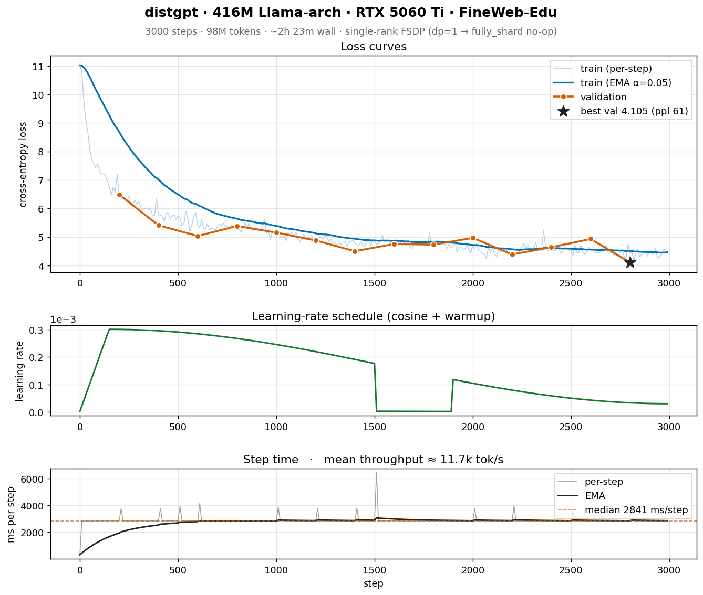
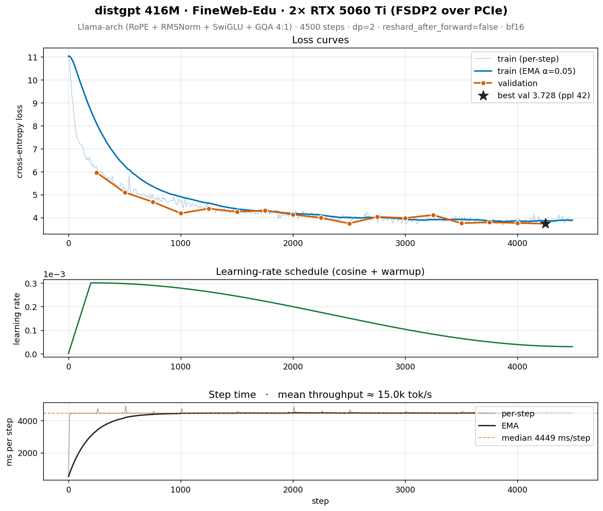
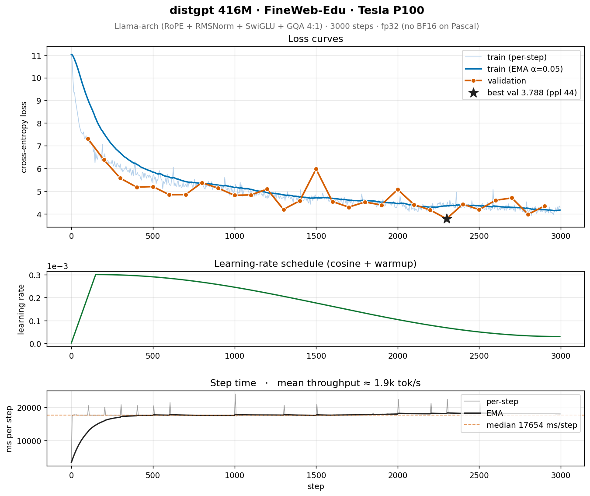

# distgpt — Distributed multi-node training framework

Real code (not pseudocode) for training **1B–70B** parameter GPTs across **multiple nodes** with:

- **FSDP2** (PyTorch native) full sharding of params + grads + optimizer state
- **Tensor Parallelism** via `torch.distributed.tensor` DTensor (column/row parallel linears)
- **Pipeline Parallelism** via `torch.distributed.pipelining` (1F1B schedule)
- **Sequence Parallelism** for memory savings on long context
- **Sharded distributed checkpointing** (DCP) — reshardable across topologies
- **Activation checkpointing** (selective or full)
- **Mixed precision** (BF16 + FP32 master)
- **Streaming dataloader** with deterministic per-rank, mid-epoch resume
- **Eval harness** (lm-eval-harness compatible)
- **W&B + JSONL logging**, loss-spike monitor, async checkpoint upload
- **Slurm + torchrun-elastic** launchers

The integrated trainer supports explicit, tested configurations rather than every
possible composition. See [the November repair contracts and support matrix](docs/repair-contracts-2026-11.md)
for complete-state checkpointing, independent validation, CPU/Gloo parity, and
tiny real CUDA FSDP evidence. PP, mixed DP×TP, and other unvalidated combinations
fail before allocation; their lower-level experiments remain available.

The small runnable recipes are `configs/repair_cpu.yaml` and
`configs/repair_fsdp.yaml`. Large-model sizes and throughput targets below are
architecture/sizing targets, not proof those recipes or every composition have
been validated. Use the [pinned test profile](../docs/testing-and-reproducibility.md)
for acceptance tests.

## Layout

> **Recent additions:** Muon optimizer (with opt-in decoupled `weight_decay`
> and `update_scale` knobs; defaults reproduce the prior update bit-for-bit),
> Liger fused linear-CE, Transformer
> Engine FP8 path, Megatron-style sequence parallelism, HuggingFace export
> + lm-evaluation-harness CLI, recipe configs (cooldown / longctx / Muon
> speedrun / **DeepSeek-V3-style**), warm-start checkpoint loading,
> **high-LR-warmup stability knobs** (per-head `qk_norm`; `zero_init_proj`
> zero-inits the residual-write matrices — attn `o_proj` + FFN/expert
> down-proj — so every block starts as the identity map; both adopted from
> nanogpt-edu / modded-nanogpt),
> **2025-frontier architecture** primitives (sparse MoE FFN with shared
> expert + aux-loss-free balancing; Multi-head Latent Attention with
> 5–10× KV-cache compression; Multi-Token Prediction auxiliary heads).
> All default-off; see
> [`docs/improvements_2026q1.md`](docs/improvements_2026q1.md) for what
> landed, why, and which latent bugs got caught along the way.

```
distgpt/
├── distgpt/
│   ├── model/
│   │   ├── config.py          # ModelConfig with param_count() + active_param_count()
│   │   ├── transformer.py     # GPT (RoPE, RMSNorm, SwiGLU, GQA, MLA, MoE, MTP)
│   │   └── parallel_layers.py # ColumnParallelLinear, RowParallelLinear, VocabParallelEmbedding
│   ├── parallel/
│   │   ├── mesh.py            # 3D device mesh (dp, tp, pp)
│   │   ├── fsdp.py            # FSDP2 wrapping policy
│   │   ├── tensor.py          # TP application via parallelize_module
│   │   └── pipeline.py        # PP stage building + schedule
│   ├── data/
│   │   ├── streaming.py       # iterable, resumable shard reader
│   │   └── mixture.py         # weighted multi-source sampler
│   ├── training/
│   │   ├── optim.py           # AdamW + cosine + per-group WD
│   │   ├── checkpoint.py      # DCP sharded save/load (reshardable)
│   │   ├── stability.py       # SpikeMonitor + RewindController
│   │   └── trainer.py         # the loop
│   ├── eval/
│   │   └── harness.py         # ppl + downstream tasks
│   ├── utils/
│   │   ├── logging.py         # JSONL + W&B + rank-zero filter
│   │   └── dist.py            # init/destroy, all_reduce helpers
│   └── cli.py                 # `distgpt train|eval|sample`
├── configs/                   # 1B / 7B / 70B YAML
├── scripts/                   # slurm + torchrun launchers
└── tests/                     # unit tests (single-process where possible)
```

## Reference topologies

| Model | GPUs       | DP | TP | PP | ZeRO | Activation | Throughput target  |
|-------|-----------:|---:|---:|---:|-----:|-----------|--------------------|
| 1B    | 8× H100    | 8  | 1  | 1  | FSDP-3 | none      | 250k tok/s         |
| 7B    | 64× H100   | 8  | 1  | 1  | FSDP-3 | selective | 1.5M tok/s         |
| 7B    | 64× H100   | 4  | 8  | 1  | ZeRO-1 | selective | 1.6M tok/s         |
| 70B   | 512× H100  | 8  | 8  | 8  | ZeRO-1 | selective | 6M tok/s           |

## Quickstart (single node, 8 GPUs, FSDP only)

```bash
pip install -c constraints-ci.txt -r requirements.txt
# Tokenize some data (or symlink a directory of *.bin uint16 shards)
python -m distgpt.data.prepare_dummy --out data/tiny --tokens 50000000

torchrun --standalone --nproc_per_node 8 -m distgpt.cli train \
    --config configs/1b.yaml --data data/tiny
```

## Multi-node via Slurm

```bash
sbatch scripts/slurm_70b.sbatch
```

## Worked example — 416 M Llama-arch on a single RTX 5060 Ti

For a single-GPU shake-out of the full stack (model + 3D mesh + streaming
loader + DCP checkpointing + spike monitor + AdamW/cosine), there's a
real reproducible run in [`examples/5060ti_416m_fineweb.md`](examples/5060ti_416m_fineweb.md):

- 416 M params · Llama-arch (RoPE + RMSNorm + SwiGLU + GQA 4:1)
- FineWeb-Edu 1 B-token slice · seq 1024 · effective batch 32 768 tokens
- **2 h 22 min** wall-clock · **11.5 k tok/s** · **12.0 GB** peak VRAM
- **Val ppl 60.7** at step 2 800 (98 M tokens trained, ~0.24× Chinchilla)



Config: [`configs/gpt_416m_fweb_5060ti.yaml`](configs/gpt_416m_fweb_5060ti.yaml).
The writeup also documents two real bugs this run surfaced (a
SpikeMonitor rewind-loop on noisy small-batch gradients, and why running
two ranks on one consumer GPU doesn't work under NCCL 2.28) and the
fixes that landed in the same commit.

## Worked example — genuine 2-GPU FSDP2 over PCIe (no NVLink)

A second RTX 5060 Ti in the box lights up the **real cross-GPU FSDP2
path** — all-gather (forward), reduce-scatter (backward), sharded
params + optimizer state, and a DCP checkpoint sharded across both ranks.
Same [`examples/5060ti_416m_fineweb.md`](examples/5060ti_416m_fineweb.md)
writeup, "Going multi-GPU" section:

- 2× RTX 5060 Ti, **no NVLink** (PCIe `PHB`, `NCCL_P2P_DISABLE=1`) ·
  FSDP2 `dp=2` · effective batch **65 536 tokens / step**
- **5 h 33 min** wall-clock · **14.7 k tok/s** aggregate · **10.3 %**
  per-GPU MFU · **12.8 GB** peak VRAM / GPU
- **Val ppl 41.6** at step 4 250 (295 M tokens, ~0.71× Chinchilla)



The naive 2-GPU config was *0.69× slower* than one GPU — every FSDP
collective crawls through host memory over PCIe. Two fixes flip it to
**1.28× positive scaling**: `reshard_after_forward=false` (skip the
backward re-gather) and gating gradient-sync to the last micro-step
(one reduce-scatter / optimizer step instead of 8). The writeup is the
full calibration story — naive→optimized tables, the OOM when a bigger
micro-batch competes for the same VRAM as Fix 1, and why the cosine tail
(not the step-2 500 plateau) produces the genuinely-best checkpoint.

Config: [`configs/gpt_416m_fweb_2gpu.yaml`](configs/gpt_416m_fweb_2gpu.yaml)
· launcher [`scripts/run_5060ti_2gpu.sh`](scripts/run_5060ti_2gpu.sh).

## Worked example — same model on a 2016 Tesla P100

The same 416 M model trained on a **single Tesla P100-PCIE-16GB** (Pascal,
sm_60, no Tensor Cores, no BF16). See [`examples/p100_416m_fineweb.md`](examples/p100_416m_fineweb.md):

- Identical config to the 5060 Ti run, only `dtype` (bf16 → fp32) and
  `micro_batch`/`grad_accum` (4/8 → 2/16) changed
- **14 h 50 min** wall-clock · **1.85 k tok/s** · **12.7 GB** peak VRAM
- **Val ppl 44.2** at step 2 300 (~12× slower than the 5060 Ti, but lower
  held-out loss thanks to fp32 precision)



Config: [`configs/gpt_416m_fweb_p100.yaml`](configs/gpt_416m_fweb_p100.yaml).
The writeup documents three more real issues this run surfaced
(CUDA 13 dropped sm_60 from the default torch wheel, a
half-broken Blackwell GPU in the same host poisoning `cuInit`, and why
the framework's bf16-only design NaNs on Pascal fp16) plus the
sidecar `.venv-pascal/` and PCI-unbind workarounds that got it running.

## Resumable rollout and verifier work queue

**The October/November harvest is a runnable local rollout/checker pipeline,
not an async RL trainer.** `distgpt/eval/rollout_queue.py` implements deterministic
ordering, fenced exclusive leases, heartbeat, bounded retries/dead-lettering,
parent lineage, and atomic versioned snapshots. `distgpt/eval/rollout_worker.py`
actually invokes generator and verifier callbacks, checks policy provenance,
and retains per-attempt costs even when work fails or returns too late.

### Offline CPU demo

From `distgpt/`, with Python 3.10+ (the demo uses only the standard library):

```bash
python -m distgpt.eval.rollout_worker --snapshot out/rollout-queue.json
python -m distgpt.eval.rollout_worker --snapshot out/rollout-queue.json --resume

# Permit behavior-policy version 0 while the learner is at version 1.
python -m distgpt.eval.rollout_worker --current-policy-version 1 --max-policy-lag 1 \
    --snapshot out/rollout-lag.json

# Stop admission at lifetime token/attempt/grader/wall allowances.
python -m distgpt.eval.rollout_worker --max-tokens 16 --max-attempts 4 \
    --max-wall-s 2 --max-grader-calls 2 --max-grader-cost 2 \
    --snapshot out/rollout-budget.json
```

The default jobs emit 3 and 64 integer tokens respectively. The checker compares
all tokens with the expected sequences. A successful fresh run reports two
completions, 2 input tokens, 67 output tokens, and 2 grader calls, with separate
`short` and `long` domain totals. Wall time is measured, not a benchmark. Grader
cost is a configurable accounting unit (default 1 per invocation), **not money
spent**. No model download, network request, paid API, GPU, or sleep is involved.
`--resume` restores the queue without resubmitting jobs or resetting accounting;
without it, the demo starts fresh and replaces the specified snapshot.

### Callback and acceptance contract

`LocalWorker(queue, generator, verifier, ...)` accepts a
`generator(item, meter) -> Generation` and
`verifier(item, generation, meter) -> dict`. Call `meter.tokens(...)` before
processing input or emitting output, including partial work that may raise an
exception. The runner charges the configured grader cost and one grader call
**before** invoking the verifier, so checker exceptions still count. It measures
attempt wall time through success, exceptions, and late responses. Token charges
are cooperative reservations; unused reservations are not refunded.

Each work item declares `domain`, `policy_version`, and `logprob_version`.
Generation returns the actual versions and one finite, nonpositive log-prob per
metered output token. Requested and actual versions must match; log-probs must
belong to the behavior-policy version. `StalenessPolicy(current_version, max_lag)`
accepts only `0 <= current_version - policy_version <= max_lag`, checking again
after verification. Future policies, mismatched provenance, and expired leases
are rejected regardless of lag tolerance. These version tags are trusted callback
metadata, not proof of which weights actually ran. The deterministic demo has
selected-token log-probs of zero; it does not estimate neural-model likelihoods.
A checker verdict such as `{"correct": false}` is a valid completed evaluation,
not a worker failure. Exceptions trigger retries up to the queue's limit.

`queue.attempts` retains requested/actual versions, domain, outcome/reason, input
and output tokens, wall seconds, grader calls, and grader cost for each lease.
`queue.totals(domain=None)` sums **all attempts**, not just accepted completions.
Cumulative usage reports cannot decrease and repeated reports do not double count;
late reports for known expired leases remain chargeable. `Budget` allowances apply
to lifetime queue totals across restore. Retry count and run-wide attempt count
are separate limits. Reclaimed leases retain their last reported usage; unreported
work from a killed process is unknown, not inferred as free or recovered exactly.

### Fences, snapshots, and compatibility

Keep the `Lease` returned by `acquire` and send its fence on every mutation:

```python
lease = queue.acquire("worker-0", now=10.0, lease_s=30.0)
if lease is not None:
    queue.complete(lease.item.item_id, lease.worker_id, {"reward": 1}, now=11.0,
                   lease_token=lease.token, attempt=lease.item.attempt)
```

`complete`, `fail`, and `heartbeat` require the keyword-only `lease_token` for
authorization; the optional `attempt` is an additional consistency check. Tokens
are unique per acquisition and persist across restore. Worker-ID-only and
attempt-only calls return `False`, even on an initial attempt: a restored pending
checkpoint can issue a different acquisition with the same worker and attempt.
This deliberate API tightening closes stale messages from reused identities.
Completion acknowledgments with the original token are idempotent and never
overwrite the first committed result.

Snapshots use schema v2, reject non-finite serialized values, fsync a temporary
file, and atomically replace the destination in the same directory. V1 snapshots
are supported: pending/completed/failed items survive, but active leases are
invalidated and requeued with incremented attempts (or dead-lettered at the
limit). Old v1 completion records remain readable but cannot authenticate duplicate
acknowledgments. V1 contains no usage history; migration cannot reconstruct costs.
Lease deadlines use caller-supplied epoch seconds; local duration accounting uses
a monotonic clock. Times, retry counts, and budgets are validated before use.

### Production boundaries and tests

This is a **single-process, synchronous, cooperative** reference implementation.
It is not thread/process-safe, a Redis/etcd adapter, a multiprocess durable DB, a
sandbox, or an RL optimizer. Snapshot replacement is not a transaction log: work
since the last saved checkpoint can be lost. Use one authoritative queue and
snapshot; do not fork or roll back live queue histories. A production backend must
atomically transact leases, fences, completions, and usage, and persist admissions
before dispatch. Worker version checks do not replace trusted model identity.

Callbacks must terminate and meter their work honestly. Wall budgets are checked
between operations and before committing results; they cannot interrupt a hung
callback and can overshoot by one callback's runtime. The runner drains available
jobs without polling or waiting for live leases to expire. Use an external process
supervisor and transactional backend for hard timeouts, concurrent dispatch, and
crash-durable metering. Model-backed generation and async learner integration are
not included.

```bash
python -m pytest -q tests/test_rollout_queue.py tests/test_rollout_fencing.py \
    tests/test_rollout_worker.py
CUDA_VISIBLE_DEVICES='' OMP_NUM_THREADS=1 python -m pytest -q
```

## What's *not* in scope

- Custom CUDA kernels (we lean on PyTorch SDPA + Transformer Engine if installed)
- Expert parallelism mesh + `all_to_all` dispatch for MoE+TP (the MoE
  layers themselves are in, but tp=1 only — Tier 6)
- Custom MLA+TP sharding plan (the MLA layer is in, tp=1 only — Tier 6)
- HuggingFace export adapters for MoE (Mixtral format) or MLA (DeepSeek
  custom class) — both exports raise `NotImplementedError` rather than
  silently produce a broken model
- RLHF (see the `frontier-platform` blueprint)
- Inference engine (use vLLM / TRT-LLM)
