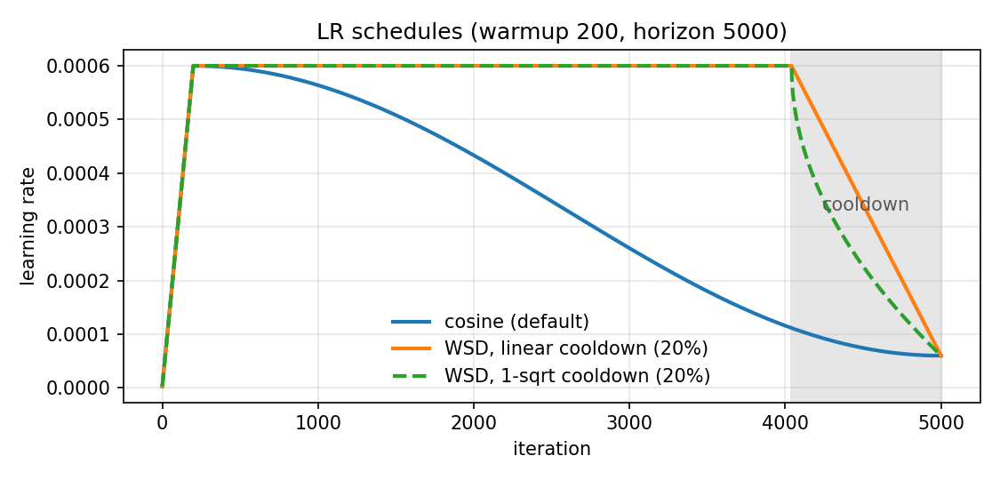
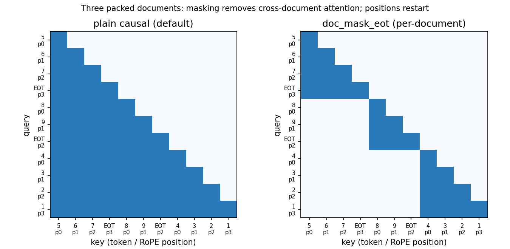
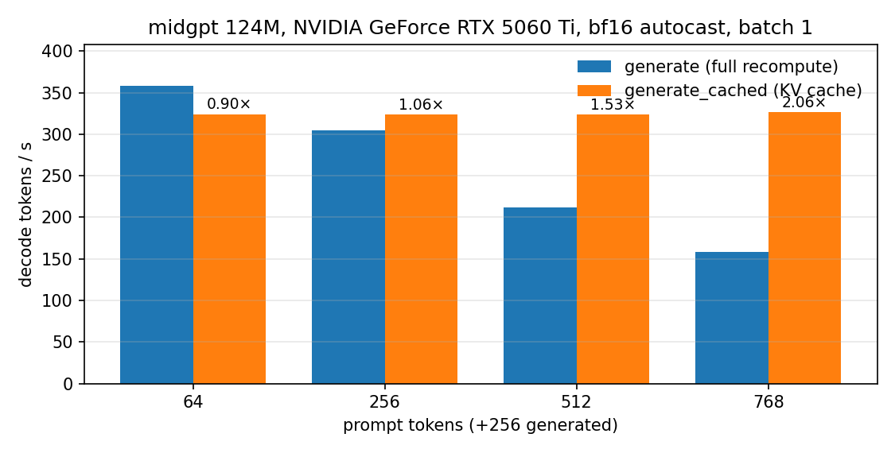

# SOTA gap analysis — post-repair deep dive

**Date:** 2026-11-11 · **Basis:** post-repair working tree (base `d020dd3`, uncommitted),
source inspection with virtual environments excluded, and the
[repair acceptance evidence](2026-11-repair-pass.md). This is a roadmap, not a
claim that any item below is implemented.

## Bottom line

The repair pass made the projects **correct and honest**. They are not yet **SOTA**.
The gap is no longer mainly bugs; it is four structural deficits:

1. **No measured quality-per-compute result.** No project yet reports a recipe
   that matches a public reference (e.g. modded-nanoGPT speedrun, GPT-2/Pythia
   evals, Qwen-Coder baselines) under the same tokens and evaluation.
2. **Modern pretraining defaults are missing where they matter.** WSD schedules,
   document-aware attention masking, logit softcap, and real data-quality
   filtering are absent in all three training projects.
3. **The validated distributed path is narrow.** distGPT's integrated trainer
   accepts only dense DP/FSDP with AdamW; TP/PP/MoE/MLA/MTP/compile/activation
   checkpointing are explicitly rejected (`trainer.py` lines 60–99).
4. **Post-training evaluation is outdated.** coder-finetune evaluates base
   HumanEval/MBPP only—both saturated and contamination-prone.

## Source-level feature matrix

Counts are regex hits in project source (tests and venvs excluded); `0` means absent.

| Feature | nanogpt | midgpt | distgpt | coder | frontier |
|---|---:|---:|---:|---:|---:|
| GQA | yes | **0** | yes | n/a | yes |
| QK-norm / Muon / MTP | yes | yes | yes (gated) | n/a | ref |
| WSD (warmup-stable-decay) schedule | **0** | **0** | **0** | n/a | **0** |
| Document masking (varlen / doc mask) | **0** | **0** | **0** | n/a | **0** |
| Logit softcap | **0** | **0** | **0** | n/a | **0** |
| Context parallelism | — | — | **0** | — | **0** |
| KV-cached generation | **0** | **0** | **0** | HF | ref only |
| Activation checkpointing in trainer | 0 | 1 | gated | HF | ref |
| FP8 training | — | — | ops exist, not trainer-validated | — | sim |

Verified directly: `midgpt/model.py:generate` recomputes the full context every
token (no KV cache); all SDPA calls use `is_causal=True`, so packed sequences
attend across document boundaries; LR schedules are cosine-only
(`cosine_lr` in nanogpt/midgpt/distgpt).

## Prioritized improvements

Priority = SOTA impact ÷ cost on available hardware (2× RTX 5060 Ti 16 GB).
Each item lists an **acceptance gate**; without it, the item is not done.

### P0 — establishes a credible SOTA claim (weeks, current hardware)

| # | Project | Improvement | Acceptance gate |
|---|---|---|---|
| 1 | nanogpt-edu | **Speedrun-parity recipe**: FineWeb 10B tokens, Muon + QK-norm + ReLU² / softcap + WSD + value embeddings, as in modded-nanoGPT | Reach 3.28 val loss on the standard FineWeb validation shard; report tokens and wall-clock vs the public record with ≥3 seeds |
| 2 | midgpt, distgpt | **Document masking** via FlexAttention `BlockMask` from EOT positions (or `flash_attn_varlen`) | Bit-exact per-document logits vs unpacked reference; ≤5% throughput loss; val loss A/B at equal tokens |
| 3 | all trainers | **WSD schedule** + decay-from-checkpoint ("cooldown" branches) | Equal-token A/B vs cosine; cooldown from a mid-run checkpoint matches a full-length run within noise |
| 4 | midgpt | **GQA + KV-cached generation** (static cache, `torch.compile`d decode) | Greedy output identical to no-cache path; ≥5× decode tokens/s at 1k context |
| 5 | coder-finetune | **Modern eval suite**: EvalPlus (HumanEval+/MBPP+), LiveCodeBench (date-windowed), BigCodeBench-Hard; decontamination report against training data | Reproduce published base-model scores for a pinned Qwen2.5-Coder within ±2 pts before reporting any fine-tune delta |

### P1 — production-grade training (1–2 months, single node)

| # | Project | Improvement | Acceptance gate |
|---|---|---|---|
| 6 | distgpt | Un-gate **activation checkpointing + `torch.compile`** under FSDP2 (per-block compile) | Gradient parity vs eager (existing FSDP parity tests); measured MFU reported |
| 7 | distgpt | Un-gate **Muon under FSDP2** (distributed Newton–Schulz on sharded DTensors) | Optimizer-state and next-update parity vs single-process Muon; resume parity |
| 8 | distgpt | **Mixed DP×TP** and **PP (1F1B / interleaved)** in the integrated trainer | Loss/grad parity vs dense reference; restart parity; currently `NotImplementedError` |
| 9 | midgpt/distgpt | **Data quality pipeline**: FineWeb-Edu classifier score filter + MinHash near-dedup + DCLM-style mixture | Equal-token ablation shows lower val loss / higher HellaSwag vs unfiltered; contamination check vs eval sets |
| 10 | coder-finetune | **On-policy RL with verifiable rewards** using vLLM rollouts + Python jail (GRPO/DAPO with dynamic sampling, token-level loss) | Live jail containment tests pass; pass@1 gain on LiveCodeBench holdout over SFT with ≥3 seeds |
| 11 | midgpt | **Mid-training / long-context extension** (RoPE base scaling, YaRN) | RULER / needle retrieval at 4× trained length; short-context regression ≤1% |

### P2 — frontier-scale features (needs ideal hardware; verify at small scale first)

| # | Project | Improvement | Acceptance gate |
|---|---|---|---|
| 12 | distgpt | **MoE in the trainer** with expert parallelism, aux-loss-free load balancing (DeepSeek-V3 bias update) | Router-balance metrics; EP all-to-all parity; equal-FLOP loss vs dense |
| 13 | distgpt | **FP8 training** (torchao `Float8Linear`, rowwise scaling) on Hopper/Blackwell | Loss curve within noise of BF16 over ≥10B tokens; throughput gain measured |
| 14 | distgpt | **Context parallelism** (ring attention / `torch.distributed.tensor.experimental.context_parallel`) | 32k+ sequence parity vs single-device; memory scaling measured |
| 15 | frontier-platform | Implement stubs **only with a design-doc update** (doctrine rule), starting with paged-KV serving via vLLM adapter and continuous-batching benchmarks | Live vLLM parity vs torch engine; latency/throughput SLO report |
| 16 | frontier-platform | **Simulator calibration** against measured midgpt/distgpt MFU numbers | Predicted vs measured step time within ±15% on two configs |

## Cross-cutting

- **Reproducibility receipts per result**: config hash, data manifest hash, seed set,
  hardware, and eval harness version—the repair pass built this plumbing; every
  new SOTA claim should emit it.
- **Hosted CI** (configured but never run remotely) should run CPU suites on every
  change, and a nightly small-GPU job should run the FSDP parity tests.
- **Leaderboard discipline**: compare only against public references under
  matching tokens/compute; report all seeds and failed attempts.

## Recommended order

1. #3 WSD and #2 document masking: small code, benefits every trainer.
2. #1 speedrun parity: the single most legible "SOTA-level" result for the repo.
3. #4 GQA/KV cache in midgpt and #5 the coder eval suite: these make later quality claims measurable.
4. #6–#7 to make distgpt's fast path usable, then #9 data quality.
5. P2 only after P0/P1 results exist; they need hardware beyond 2× 16 GB.

## Constraints respected

No cross-project imports are proposed; each improvement lands in its own
project. Frontier-platform stub bodies require a matching `docs/` design update.

## Implementation status (2026-11-11, uncommitted)

| # | Item | Status | Evidence |
|---|---|---|---|
| 3 | WSD schedule | ✅ code, 🔜 A/B | Opt-in `lr_schedule: wsd` (`wsd_decay_frac`, `wsd_decay_shape: linear\|1-sqrt`) in nanogpt-edu, midgpt and distgpt; cosine remains default. Tests: warmup parity, constant plateau, cooldown shape, horizon-independent plateau, invalid settings rejected (distgpt validates before mutation). Equal-token loss A/B vs cosine **not yet run**. |
| 2 | Document masking | ✅ code, 🔜 A/B | Opt-in `doc_mask_eot` in midgpt (SDPA and flex) and distgpt (dense GQA; MLA rejected). EOT closes its document; positions restart per document. Tests: packed logits equal isolated-document logits (learned-pos and RoPE/QK-norm), finite gradients incl. activation checkpointing. Uses a dense boolean mask, so the ≤5% throughput gate and val-loss A/B are **not yet measured**. |
| 4 | midgpt KV cache | 🟡 partial | `generate_cached` is token-identical to `generate` in the fp32 CPU tests (greedy and seeded top-k/top-p, including window overflow). GPU sweep below: speedup grows with context, **0.90× at 64 → 2.06× at 768 prompt tokens**. **Misses the ≥5× gate**; it is slower than full recompute for short prompts. Under bf16 one 768-token run diverged at generated token 134, where the full path's top-2 logit margin was 0.016 (a near-tie). Three separate bf16 and fp32 seeds stayed identical, so that is kernel rounding, not a cache bug. Next: preallocated static cache, `torch.compile`d decode / CUDA graphs. GQA in midgpt not yet added. |

Suites after these changes: nanogpt-edu 246 passed; midgpt 181 passed; distgpt
204 passed, 10 skipped (CPU). Ruff and `git diff --check` pass. These are code
correctness results, not model-quality improvements.

### Figures

Generated by [`midgpt/tools/plot_sota_p0.py`](../midgpt/tools/plot_sota_p0.py)
from the shipped functions and a measured receipt; rerun it to refresh.

**WSD vs cosine.** Curves are computed by `utils.cosine_lr` / `utils.wsd_lr`.
WSD holds peak LR, so a plateau checkpoint can branch into a cooldown of any
length. This chart shows schedule shape only, not a training result.

**Document masking.** Mask computed by `model.document_layout` for three packed
documents. Off-diagonal blocks are removed, and positions (`p`) restart per document.

**KV-cache decode throughput.** One run per point on one RTX 5060 Ti, 124M RoPE
model, bf16 autocast, batch 1, greedy, 256 new tokens; raw numbers in
[`kv_cache_bench.json`](../midgpt/docs/figures/kv_cache_bench.json)
(`midgpt/tools/bench_kv_cache.py`). Full-recompute cost grows with context, so
the cache only pays off beyond roughly 256 prompt tokens in this unoptimized loop.

